<!-- Images in assets/ are generated: edit scripts/build_assets.py, run it, commit. -->
<a href="https://boon-boon.github.io"><picture><source media="(prefers-color-scheme: dark)" srcset="assets/hero-dark.svg" /><source media="(prefers-color-scheme: light)" srcset="assets/hero-light.svg" />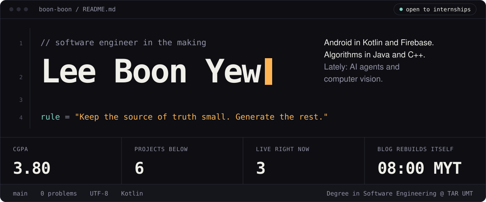</picture></a>

  <a href="https://boon-boon.github.io"><picture><source media="(prefers-color-scheme: dark)" srcset="assets/btn-portfolio-dark.svg" /><source media="(prefers-color-scheme: light)" srcset="assets/btn-portfolio-light.svg" /></picture></a>
  <a href="https://boon-boon.github.io/resume/Lee_Boon_Yew_Resume.pdf"><picture><source media="(prefers-color-scheme: dark)" srcset="assets/btn-resume-dark.svg" /><source media="(prefers-color-scheme: light)" srcset="assets/btn-resume-light.svg" />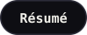</picture></a>
  <a href="https://www.linkedin.com/in/boon-yew-lee-47228836b/"><picture><source media="(prefers-color-scheme: dark)" srcset="assets/btn-linkedin-dark.svg" /><source media="(prefers-color-scheme: light)" srcset="assets/btn-linkedin-light.svg" /></picture></a>
  <a href="https://github.com/boon-boon?tab=repositories"><picture><source media="(prefers-color-scheme: dark)" srcset="assets/btn-repos-dark.svg" /><source media="(prefers-color-scheme: light)" srcset="assets/btn-repos-light.svg" /></picture></a>

## Selected work

Each card shows how the project is put together, not just what it is.

<a href="https://github.com/boon-boon/Daily-AI-Tech-News-Blog-Automation"><picture><source media="(prefers-color-scheme: dark)" srcset="assets/project-daily-tech-pulse-dark.svg" /><source media="(prefers-color-scheme: light)" srcset="assets/project-daily-tech-pulse-light.svg" />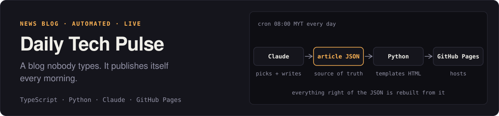</picture></a>

Updates itself every morning at 08:00 MYT. **Claude does the thinking, Python does the templating and GitHub does the hosting.** The article JSON files are the only source of truth. Everything else is rebuilt from them. [Code](https://github.com/boon-boon/Daily-AI-Tech-News-Blog-Automation) · [**Live site →**](https://boon-boon.github.io/Daily-AI-Tech-News-Blog-Automation/)

<a href="https://github.com/briankxm/msl-recognition"><picture><source media="(prefers-color-scheme: dark)" srcset="assets/project-msl-recognition-dark.svg" /><source media="(prefers-color-scheme: light)" srcset="assets/project-msl-recognition-light.svg" />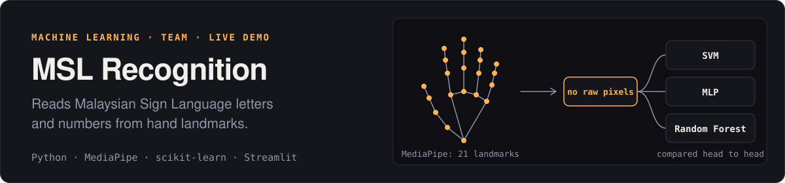</picture></a>

**It classifies MediaPipe hand landmarks rather than raw pixels, then compares SVM, MLP and Random Forest head to head.** Team project. [Code](https://github.com/briankxm/msl-recognition) · [**Try the demo →**](https://msl-recognition-alphabet-and-numbers.streamlit.app/)

<a href="https://github.com/nestchao/Odyssey_Travel_Package_Booking_App"><picture><source media="(prefers-color-scheme: dark)" srcset="assets/project-odyssey-travel-dark.svg" /><source media="(prefers-color-scheme: light)" srcset="assets/project-odyssey-travel-light.svg" />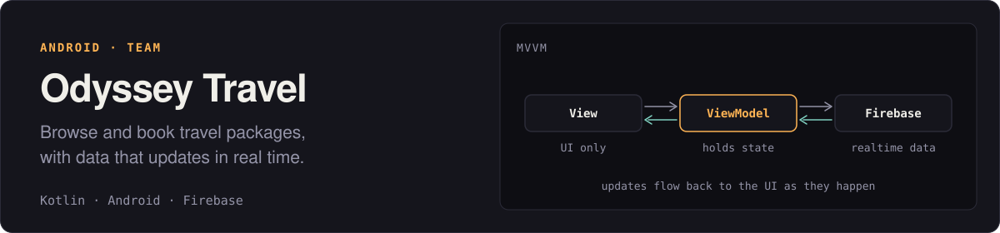</picture></a>

**Built with MVVM, which keeps the UI separate from the Firebase data layer that pushes updates in real time.** Team project. [Code](https://github.com/nestchao/Odyssey_Travel_Package_Booking_App)

<a href="https://github.com/boon-boon/boon-boon.github.io"><picture><source media="(prefers-color-scheme: dark)" srcset="assets/project-portfolio-dark.svg" /><source media="(prefers-color-scheme: light)" srcset="assets/project-portfolio-light.svg" />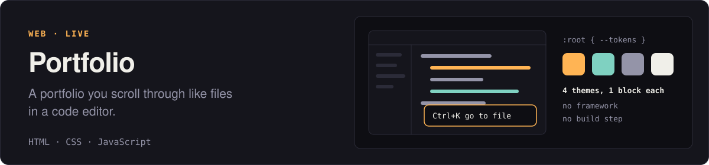</picture></a>

It has a Ctrl+K command palette, a working terminal and a git-graph timeline. **Every theme is one block of CSS tokens, with no frameworks and no build step.** [Code](https://github.com/boon-boon/boon-boon.github.io) · [**Visit →**](https://boon-boon.github.io)

### Earlier work

| Project | What it does | Built with |
| :-- | :-- | :-- |
| [CNM Clothing POS](https://github.com/boon-boon/CNM-COMPANY) | Console point-of-sale and inventory system for a clothing store. **It validates the card number, CVV, expiry date and PIN before a sale goes through**, and produces daily sales reports. | `C++` |
| [Online Shopping System](https://github.com/boon-boon/Online-Shopping-System) | Java desktop shop for adding, editing and searching products. **Built on core OOP principles, with a FlatLaf-styled Swing UI.** | `Java` `Swing` |

## Stack

Grouped by where the code runs. Every entry is used in a project on this page.

| | |
| :-- | :-- |
| **Languages** | `Kotlin` `Java` `C++` `Python` `TypeScript` `JavaScript` `HTML` `CSS` |
| **Mobile** | `Android Studio` `Firebase` `MVVM` |
| **Desktop & console** | `Visual Studio` `Java Swing` `Tkinter` |
| **Data & AI** | `scikit-learn` `pandas` `OpenCV` `MediaPipe` `Streamlit` `Claude` |
| **Tools** | `Git` `GitHub` `GitHub Actions` `VS Code` |

**Learning now:** Android architecture, data structures, and ML pipelines that hold up outside a notebook. 
**Also:** NSSPC 2023 competitor · Cisco CCNA: Introduction to Networks

## Activity

<!-- Generated daily by .github/workflows/summary-cards.yml and snake.yml -->

<picture><source media="(prefers-color-scheme: dark)" srcset="https://raw.githubusercontent.com/boon-boon/boon-boon/main/profile-summary-card-output/github_dark/3-stats.svg" /><source media="(prefers-color-scheme: light)" srcset="https://raw.githubusercontent.com/boon-boon/boon-boon/main/profile-summary-card-output/github/3-stats.svg" />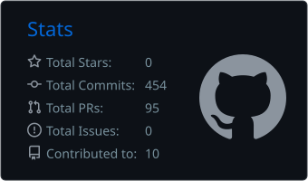</picture>
<picture><source media="(prefers-color-scheme: dark)" srcset="https://raw.githubusercontent.com/boon-boon/boon-boon/main/profile-summary-card-output/github_dark/4-productive-time.svg" /><source media="(prefers-color-scheme: light)" srcset="https://raw.githubusercontent.com/boon-boon/boon-boon/main/profile-summary-card-output/github/4-productive-time.svg" />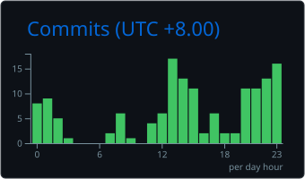</picture>
<picture><source media="(prefers-color-scheme: dark)" srcset="https://raw.githubusercontent.com/boon-boon/boon-boon/main/profile-summary-card-output/github_dark/1-repos-per-language.svg" /><source media="(prefers-color-scheme: light)" srcset="https://raw.githubusercontent.com/boon-boon/boon-boon/main/profile-summary-card-output/github/1-repos-per-language.svg" />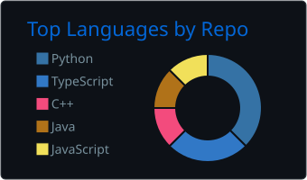</picture>
<picture><source media="(prefers-color-scheme: dark)" srcset="https://raw.githubusercontent.com/boon-boon/boon-boon/main/profile-summary-card-output/github_dark/2-most-commit-language.svg" /><source media="(prefers-color-scheme: light)" srcset="https://raw.githubusercontent.com/boon-boon/boon-boon/main/profile-summary-card-output/github/2-most-commit-language.svg" />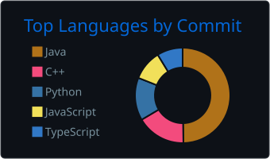</picture>

<picture><source media="(prefers-color-scheme: dark)" srcset="https://streak-stats.demolab.com?user=boon-boon&hide_border=true&background=00000000&ring=FFB454&fire=FFB454&currStreakLabel=FFB454&currStreakNum=F0EFE9&sideNums=F0EFE9&sideLabels=9494A8&dates=9494A8&stroke=2B2B38" /><source media="(prefers-color-scheme: light)" srcset="https://streak-stats.demolab.com?user=boon-boon&hide_border=true&background=00000000&ring=A85F00&fire=A85F00&currStreakLabel=A85F00&currStreakNum=16161D&sideNums=16161D&sideLabels=5F5F72&dates=5F5F72&stroke=D9D9E2" /></picture>

<picture><source media="(prefers-color-scheme: dark)" srcset="https://raw.githubusercontent.com/boon-boon/boon-boon/output/github-snake-dark.svg" /><source media="(prefers-color-scheme: light)" srcset="https://raw.githubusercontent.com/boon-boon/boon-boon/output/github-snake.svg" /></picture>

## Contact

<a href="mailto:leeboonyew06@gmail.com"><picture><source media="(prefers-color-scheme: dark)" srcset="assets/contact-dark.svg" /><source media="(prefers-color-scheme: light)" srcset="assets/contact-light.svg" />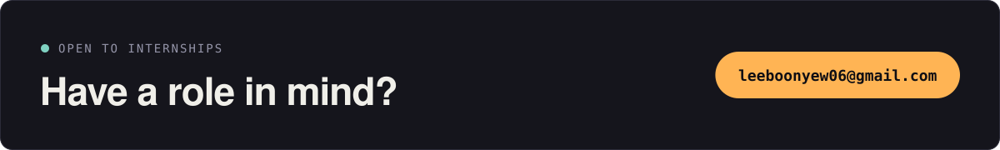</picture></a>

  <a href="mailto:leeboonyew06@gmail.com">leeboonyew06@gmail.com</a> ·
  <a href="https://www.linkedin.com/in/boon-yew-lee-47228836b/">LinkedIn</a> ·
  <a href="https://boon-boon.github.io">boon-boon.github.io</a>

